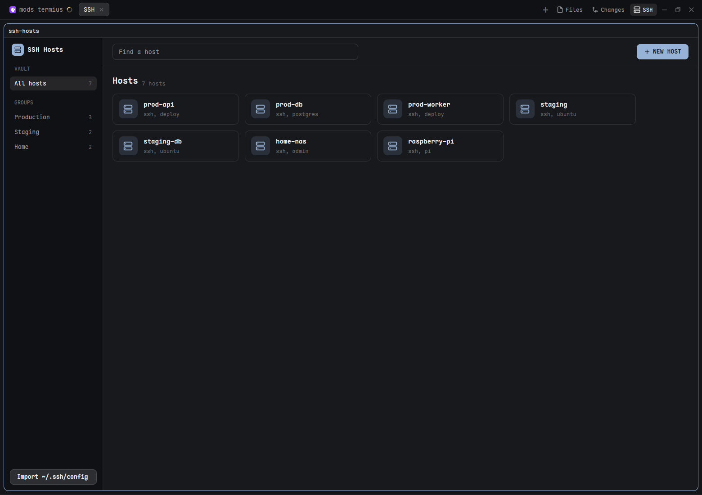

# SSH Hosts

A Termius-style SSH manager that opens as its own tab in Herdr. A host list on the left by group, a search bar and a blue NEW HOST button on top, and a grid of host cards. Double-click a card and `ssh` runs in a new tab. A small "SSH" button sits in the tab bar next to Files and Changes and opens the tab.



## What you see

One full tab (the tab's only pane is the mod), three columns, on the theme `background`:

- **Left sidebar, 210px wide**, `chrome` background, 1px `border` on its right, 12px padding:
  - Brand row: a 26px rounded tile in `accent` with a server icon, and "SSH Hosts" (14px, semibold).
  - "VAULT" caption (11px, `dim`), then an "All hosts" row with the total count.
  - "GROUPS" caption, then one row per group with its host count. Hosts without a group sit under "Ungrouped".
  - Rows are 30px high, 7px radius, 12.5px text; the active one has the `selected` background and `foreground` text.
  - At the bottom, an outlined "Import ~/.ssh/config" button (32px).
- **Top bar, 60px**, 1px `border` below: a search input (34px, max 520px wide, `input` border, `accent` while focused, placeholder "Find a host") and, at the right, a solid `accent` "NEW HOST" button with a plus icon (32px, semibold, 12.5px).
- **Content**, scrolls vertically, 20px side padding: a heading (18px, semibold; the group name or "Hosts") with a small "N hosts" count (12px, `dim`), then a wrapping grid, 12px gap, of cards:
  - Card: 268 x 66px, 10px radius, 1px `border`, `surface` background, 12px padding.
  - A 40px rounded tile tinted `accent` at 15% (`accent + "26"`) holding a 20px server icon in `accent`.
  - The label (13.5px, semibold) over `ssh, <user>` (11.5px, `dim`). An imported ssh-config host shows `ssh, <alias>`.
  - Selected card: `accent` border, `raised` background, the subtitle becomes `user@host:port`, and four 26px icon buttons appear on the right: terminal (connect), split, pencil (edit), trash (delete, `blocked` color).
  - Empty states: no hosts at all shows a 56px tile, "Add your first host" and "Press NEW HOST, or import your ~/.ssh/config."; a search or group with no match shows "No host matches".
- **Right form panel, 320px**, `chrome` background, 1px `border` on its left, only while adding or editing: title "New host" / "Edit host" with an x button; inputs Label, Address, Username, Port, Group, "Identity file (optional)" (each 34px, 13px text); an error line in `blocked`; Cancel (outlined) and Save (solid `accent`) buttons.
- **Tab bar button** (outside the mod): "SSH" with the server icon, same 26px pill style as Files and Changes, right after Changes. It has the `selected` background while the SSH tab is the active tab.

## How it behaves

- Single click selects a card. Double-click, the terminal button, or Enter in the search box (first match) opens a new tab named after the host and running the ssh command. The split button runs `pane.split` right with the same command in the current tab.
- Search filters by label, address, user, group and alias, together with the selected group.
- NEW HOST opens the form with the current group prefilled. Pencil fills it with the host. Save needs an address (imported alias hosts are exempt) and a numeric port; otherwise the message "Address is required." or "Port must be a number." shows. Enter in any field saves. Esc or the x closes the form.
- Trash removes the host at once and saves (no confirmation, no undo). If its group becomes empty, the view goes back to All hosts.
- "Import ~/.ssh/config" adds every named, non-wildcard `Host` not already saved, in the group "ssh config", and posts a toast "Imported N from ~/.ssh/config" or "Nothing new in ~/.ssh/config". Imported hosts connect with `ssh <alias>`, so ssh applies its own config.
- The SSH tab-bar button selects the existing tab named "SSH" in the current space, or creates it.
- Agent statuses (working, blocked, done, idle) have no effect on this mod.

## Built from

Files: `mods/ssh-hosts/main.js`, `mod.json` (`{ "place": "none" }`), and icons `server.svg`, `terminal.svg`, `split.svg`, `pencil.svg`, `trash.svg`, `plus.svg`, `x.svg` (24px viewBox, `stroke="currentColor"`, stroke-width 2, round caps and joins, Lucide-style). Draw them with `svg("mods/ssh-hosts/<name>.svg")`. No `keys.json` is needed.

- `main.js` default-exports a `View` and imports `div`, `svg` from `gpui-kit`; `v_flex`, `h_flex`, `InputState`, `Input` from `gpui-base`; `run`, `theme`, `appHome`, `home`, `readTextFile`, `writeTextFile`, `notify` from `herdr`. Export nothing else from the file.
- Root: `h_flex().size_full()` with sidebar, main column, and the form panel (only when open). Cards use `flex_wrap().gap(12)`. Double-click is detected in `on_mouse_down("left", e => e.click_count === 2)`.
- One `InputState` for search and one per form field, each with `change`, `focus`, `blur` and `submit` handlers.
- Storage: `<appHome>/data/ssh-hosts.json` as `{ "hosts": [ { label, host, user, port, group, identity, alias? } ] }`. Read in `init` with `readTextFile`. Written with `writeTextFile(path, text, previousText)`, keeping the last text read or written so the stale check passes. A failed write shows "Couldn't save: ..." under the grid.
- ssh argv: alias host is `["ssh", alias]`. Otherwise `["ssh", "-p", port (only if not 22), "-i", identity (leading `~` replaced by `home()`, only if set), "user@host"]`, with no `user@` when user is empty.
- Commands: `tab.new { name, argv }`, `pane.split { direction: "right", argv }`.
- Programs: only `ssh`, started through those commands. It reads `~/.ssh/config` and writes only its data file. It makes no network calls of its own.

### The tab-bar button

Shipped mods are read-only, so clone the tab bar and add the button to the clone:

1. `herdr-app do mod.clone --name tabs --as my-tabs`
2. In `mods/my-tabs/main.js`, build this pill (same look as `panelButton`) and add `.child(sshButton)` right after the Changes button in the returned row:
   ```js
   const sshTab = shown.find(x => x.name === "SSH");
   const sshButton = h_flex().id("panel-ssh").h(26).px(8).gap(5).flex_none().items_center().rounded(6)
     .text_size(12).bg(sshTab?.active ? t.selected : t.chrome).text_color(sshTab?.active ? t.foreground : t.muted)
     .hover(s => s.bg(t.hover)).on_mouse_down("left", stop)
     .on_click(() => sshTab ? run("tab.select", { id: sshTab.id }) : run("tab.new", { name: "SSH", mod: "ssh-hosts" }))
     .child(svg("mods/ssh-hosts/server.svg").size(14)).child("SSH");
   ```
3. In the layout file, point the tab bar block's `content.mod` at `my-tabs`. Clone a shipped layout first if the person is on one.

Without the button the tab still works: `herdr-app do tab.new --name SSH --mod ssh-hosts`.

## Watch out

- `tab.new` takes `mod`, not `name` of a mod, and `--name` is the tab title. `mod.open:ssh-hosts` opens it as a dialog, which is not the intended form.
- Passwords are never stored. Use ssh keys, or type the password in the terminal that opens.
- No drag to reorder, no moving between groups except editing the Group field. No folders inside groups, no SFTP, no port forwarding, no tags (unlike Termius).
- Connections are plain local ssh terminals, not Herdr machines (`hc machine add`).
- Assumes `ssh` is on PATH (OpenSSH ships with current Windows).
- Selecting a card shows the buttons; hover alone does not.
- The grid wraps at 268px cards, so there are no columns to configure.

## Done when

- `herdr-app check mods/ssh-hosts` passes and `herdr-app status` shows no errors.
- The SSH button appears after Changes in the tab bar, and clicking it opens or focuses a tab named SSH showing the three-column view.
- NEW HOST, then Save, adds a card under its group and the sidebar counts update; `data/ssh-hosts.json` contains it.
- Double-clicking the card opens a new tab named after the host that runs `ssh user@host` (with `-p` for a port other than 22).
- Search narrows the cards, and Enter opens the first match.
- Pencil edits and trash deletes; both persist after closing and reopening the tab.
- Import adds the named hosts of `~/.ssh/config` once; running it again says nothing new.
